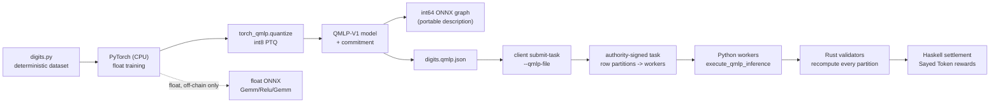

# AI workloads: what is verifiable

AivoBlock validators accept an AI result into a block only if they can
**recompute it exactly**. That rule decides which workloads exist on chain.

| Workload | In consensus | Verification | Where |
| --- | --- | --- | --- |
| Integer linear model | yes | full Rust recomputation | `ai-work-block-v3.md` |
| QMLP-V1 quantized two-layer MLP (int8 weights/inputs, exact integer requantization) | yes | full Rust recomputation, bit-exact with the Python worker | `quantized-mlp-v1.md`, `node/src/qmlp.rs`, `aivoblock_ai/qmlp.py` |
| Float PyTorch model | **no** | none: outputs vary with CPU, kernels, threads and versions | `aivoblock_ai/torch_qmlp.py` (training only) |
| Float ONNX model | **no** | none (ONNX Runtime agrees with PyTorch only approximately) | `aivoblock_ai/onnx_qmlp.py` |
| Integer ONNX graph of a QMLP-V1 model | only via the QMLP-V1 spec | CI checks ONNX Runtime reproduces the consensus logits exactly; validators never run ONNX | `aivoblock_ai/onnx_qmlp.py` |
| Large models, convolution/attention, GPU inference | no | would need succinct proofs or trusted hardware | not implemented |

All verification is **full recomputation**. It costs the validator as much as
the worker spent, so it is a correctness mechanism for small models, not a
succinct, zero-knowledge or optimistic proof.

## The pipeline from PyTorch to a block



1. `aivoblock_ai.digits` generates noisy 8x4 digit glyphs with a fixed 64-bit
   LCG, so the data is identical on every platform and already int8.
2. PyTorch trains `Linear(32, 32) -> ReLU -> Linear(32, 10)` on CPU.
3. `torch_qmlp.quantize` performs symmetric per-tensor int8 post-training
   quantization: weights to int8, biases to int32 in accumulator units, and the
   hidden scale ratio to a 31-bit multiplier plus shift.
4. The QMLP-V1 model is committed (`SHA-256` of its canonical body) and
   exported with a batch of inputs as `digits.qmlp.json`.
5. `aivoblock-node client submit-task --qmlp-file digits.qmlp.json` creates
   an authority-signed task whose rows are partitioned across registered
   workers. Each worker runs the Python reference; the node refuses to sign if
   it differs from the Rust reference; every validator recomputes every
   partition before voting; Haskell settles fees and issuance by assigned rows.

Run the off-chain part locally (CPU PyTorch is a large download):

```bash
pip install --index-url https://download.pytorch.org/whl/cpu torch
pip install -e "ai-engine[dev,research]"
python -m aivoblock_ai.research --out research-out
```

Run the actual **three-node private blockchain** using the model exported above
(requires Docker with Compose v2; builds the Haskell/Rust/Python node image):

```bash
python3 scripts/testnet.py demo --qmlp-file research-out/digits.qmlp.json
```

The final task is read from `digits.qmlp.json` inside node-1, signed by the
testnet authority, split among the real Python workers, recomputed by each Rust
validator and settled through Haskell after BFT finality. The harness checks
that all three nodes agree on the chain/state root and that worker balances
match an **independent Python Sayed Token reward model**. This is a private
research network using generated keys, not a public-chain deployment. CI
downloads the exact trained model artifact from the off-chain research job and
runs this same end-to-end demonstration.

`research-out/report.json` records the accuracy of the float and integer
models, their agreement, the ONNX Runtime float deviation from PyTorch and
whether the integer ONNX graph matched exactly, together with library
versions. The CI job **PyTorch / ONNX off-chain research** runs this, then
runs the Rust test `exported_pytorch_qmlp_model_matches_rust_when_provided`
on the exported file, and uploads the report and both ONNX files as the
`pytorch-onnx-research` artifact.

## Why ordinary float execution stays out of consensus

Float addition is not associative. Vectorized kernels, fused multiply-add,
BLAS blocking, thread counts and library versions change summation order and
rounding, so two honest validators can compute different bits for the same
float model. The off-chain experiment measures this directly between PyTorch
and ONNX Runtime on one machine; across CPUs and versions the differences can
only grow. Reproducibility across supported platforms has **not** been
demonstrated, so float outputs are reported for research and never committed.

## Limitations

- Models are tiny (at most 32 inputs, 64 hidden units, 16 outputs, 256 rows
  per task) because every validator recomputes everything.
- Partitioning is by input rows (data parallel). Layer or tensor splitting is
  not implemented; at these sizes it would only add committed intermediate
  activations.
- Quantization is simple per-tensor symmetric PTQ, without calibration
  refinements or quantization-aware training.
- Workers are rewarded by assigned rows, not by measured compute.
