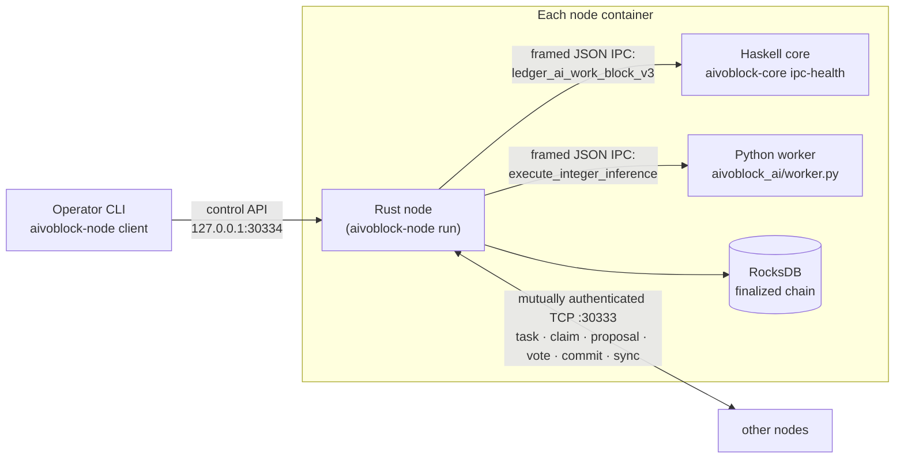
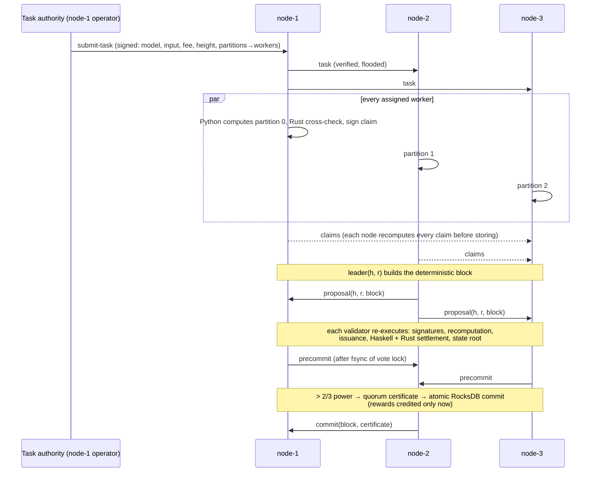

# AivoBlock private research testnet

A reproducible Docker testnet in which independent nodes authenticate each
other, distribute a deterministic AI task across workers, independently
recompute every submitted result, finalize blocks by validator quorum, pay
native Sayed Token rewards and recover their finalized history after restart.

> **Private research testnet only.** Generated keys are test keys, the
> transport is unencrypted, and the validator set is permissioned. Do not
> deploy publicly or attach real value to balances.

## What is (and is not) proven

| Property | Status |
| --- | --- |
| Worker results equal the committed model applied to the committed input | **Yes**, by full independent recomputation in Rust on every validator |
| Results come from the assigned, registered worker | **Yes**, authority-signed assignment + Ed25519 worker signature |
| Arbitrary or large-model AI computation is efficiently or cryptographically proven | **No.** The workload is a small integer linear model (≤ 256 rows × 32 features) and verification costs as much as computing it. There are no succinct, zero-knowledge or optimistic proofs. |
| BFT safety with ≤ 1/3 faulty voting power | Yes for the implemented fixed-set protocol (durable one-block-per-height locks + > 2/3 quorum certificates) |
| Liveness under Byzantine leaders | Partial: crash faults and leader crashes are handled by round changes; equivocating leaders can stall a height |
| Sybil resistance, stake, slashing, validator rotation | Not implemented (permissioned set) |

## Architecture



Component responsibilities:

| Component | Role in the testnet |
| --- | --- |
| Rust `node/src/testnet` | P2P transport, consensus state machine, task pool, sync, restart replay, control API |
| Rust `ai_block_v3` | Task/assignment/claim/block encoding, signature checks, **independent recomputation** |
| Haskell `AivoBlock.Issuance` + `Settlement` | Authoritative Sayed Token transition: issuance schedule, fee-funded payout, replay markers |
| Rust `issuance` | Independent mirror of the Haskell transition; blocks are rejected unless both agree byte for byte |
| Python `aivoblock_ai` | The AI worker executes its partition; `rewards.py` lets the harness predict balances |
| RocksDB | One synced batch per finalized block: block, certificate, height index, ledger, markers, vote locks |

### One block, end to end



Specifications: [AI-work block V3](../protocol/spec/ai-work-block-v3.md),
[testnet consensus and networking](../protocol/spec/testnet-consensus-v1.md),
[Sayed Token issuance](../protocol/spec/sayed-token-issuance-v1.md).

## Run it

Prerequisites: Docker with Compose v2 and Python 3.11+ (no other toolchain;
the image builds the Haskell core, the Rust node and the Python worker).

```bash
python3 scripts/testnet.py demo
```

```bash
python3 scripts/testnet.py fault
```

```bash
python3 scripts/testnet.py all
```

- `demo` — three-node network (`testnet/compose.three-node.yaml`).
- `fault` — four validators (`testnet/compose.four-validator.yaml`).
- `--skip-build` reuses `aivoblock-node:testnet`; `--keep` leaves containers
  running for inspection; `down --profile <name>` removes them.
- Keys, the signed `network.json`, `compose.log` and `report.json` are written
  to `testnet/generated/<profile>/` (git-ignored). Each node mounts only its
  own key directory; only node-1 holds the task-authority key.

Inspect a running network (`--keep`):

```bash
docker compose -f testnet/compose.three-node.yaml -p aivoblock-three-node exec node-2 aivoblock-node client status
```

### What `demo` verifies (three nodes, quorum 3 of 3)

1. Containers start, every node verifies the signed configuration and genesis
   under the pinned authority key, and all three mutually authenticate.
2. A connection with an unregistered key is refused (`probe-unauthorized`).
3. Task 1 is the repository's original deterministic workload
   (`[[1,2],[3,4],[-2,5]] · [2,3]`), one row per worker; task 2 is a seeded
   24×8 matrix split across all workers.
4. Every validator recomputes all partitions, the leader's deterministic
   block gathers 3/3 precommits and is finalized.
5. Rewards: the harness independently computes the scheduled issuance and
   the largest-remainder split per block and checks every balance, the fee
   pool and total supply on **every** node, plus identical heights, tips,
   state roots and full block histories.
6. The adversarial suite (below) runs against node-1; nothing changes state.
7. `docker compose restart node-3`: node-3 replays all finalized blocks from
   RocksDB (certificates, recomputation, Haskell settlement) before rejoining,
   then a fifth block finalizes with all three nodes.

### What `fault` verifies (four validators, quorum 3 of 4)

1. Height 1 with four workers; then node-4 is **stopped** and heights 2–3
   finalize with the remaining 3/4 voting power.
2. node-4 restarts, replays its one local block and **syncs** heights 2–3 as
   certified commits from peers; all four states match.
3. The round-0 **leader** of the next height is killed before the task is
   submitted; the remaining validators time out, change round, and finalize
   under the next leader (`round >= 1` is asserted); the killed node then
   recovers and catches up.

### Adversarial suite (`aivoblock-node client adversarial`)

Run against a live node through the same validation path as peer messages:

| Case | Expected |
| --- | --- |
| Tampered block bytes proposed for the next height | rejected |
| Finalized block replayed as a new proposal | rejected (wrong parent) |
| Finalized commit replayed | ignored (already finalized) |
| Settled task resubmitted | rejected (replay) |
| Precommit with a forged signature / from an unknown key | rejected |
| Task with a forged authority signature / signed by an untrusted key | rejected |
| Expired task (deadline below the next height) | rejected |
| Overlapping partitions / partition assigned to an unregistered worker | rejected |
| Malformed task bytes | rejected |
| Legitimate task submitted twice | accepted, then duplicate |
| Manipulated result re-signed by the **assigned** worker | rejected (recomputation) |
| Correct result with a forged worker signature | rejected |
| Claim for a partition assigned to a different worker | rejected |
| Same honest claim submitted twice | duplicate |

Additional adversarial coverage lives in unit tests: corrupted bytes at
several offsets, inflated issuance, altered state roots, out-of-range model
values, gapped partitions, replay of a settled task at the next height,
malformed and oversized IPC replies, duplicated JSON keys, cross-height /
cross-round / cross-set vote replay, and supply-violating storage writes.

## Verified results

First full run in GitHub Actions (`ubuntu-24.04`, job *Docker private
testnet*, [run 39512658389](https://github.com/jihadelsayed/AivoBlock/actions/runs/39512658389),
commit `ec96aef`); every line below was asserted by the harness on every node.

**Three-node demo** (quorum 3/3, all checks passed in 15 s):

| Step | Observed |
| --- | --- |
| Mutual authentication | 3 nodes, each with 2 authenticated peers, after 1.5 s; unregistered key refused and counted |
| Engines | every node: Haskell settlement cross-checked by the Rust mirror; Python worker |
| Height 1 | original fixture workload, 3 worker partitions, 3/3 precommits, finalized 1.5 s after submission |
| Height 2 | seeded 24×8 workload, 3 partitions, finalized in 1.5 s |
| Adversarial suite | all 19 cases behaved as expected (see table below): every forged, expired, overlapping, manipulated, tampered or replayed input refused with the exact reason, e.g. `Claimed AI result differs from independent recomputation`, `Block does not extend the finalized parent`, `task expired: deadline 2 is below next height 3` |
| Heights 3–4 | the pending legitimate adversarial-suite task plus a new one; both finalized |
| Restart of node-3 | replayed 4 finalized blocks from RocksDB, reused its chain, rejoined; height 5 finalized by all three |
| Economics | supply 101 000 → 101 250 (5 × 50 issued); fee pool 1 000 → 858 (budgets 30+40+12+30+30); workers paid 132 + 132 + 128 = 392 = 142 fees + 250 issuance — identical on all nodes and equal to the independent Python prediction |

**Four-validator fault scenario** (quorum 3/4, all checks passed in 19 s):

| Step | Observed |
| --- | --- |
| Height 1 | 4 worker partitions, finalized with ≥ 3/4 precommits |
| node-4 stopped | heights 2 and 3 finalized by the remaining 3 validators (3/4 power) |
| node-4 restarted | replayed its 1 persisted block, synced 2 certified blocks, identical state |
| Leader crash | node-3, round-0 leader of height 4, killed; height 4 finalized in **round 1** by the next leader; node-3 then recovered |
| Economics | supply 101 200 (4 × 50); fee pool 880; workers 74 + 47 + 101 + 98 = 320 = 120 fees + 200 issuance on all nodes |

**Benchmarks** (`bench --iterations 20`, release build in the CI container,
largest accepted task: 256 rows × 32 features, 64 partitions, 75 KB block):

| Operation | Time |
| --- | --- |
| Worker: compute + sign one 4-row partition (Rust reference) | 21 µs |
| Verify one claim (signature + recomputation) | 54 µs |
| Full block verification, Rust mirror settlement | 3.7 ms (≈ 68 000 rows/s) |
| Full block verification, Haskell settlement + mirror cross-check | 20.8 ms (dominated by spawning the Haskell process) |
| Quorum certificate verification, 4 / 64 validators | 0.20 ms / 3.0 ms |

These are wall-clock numbers on a shared CI runner, not a performance claim.
End-to-end finality in the demo is ~1.5 s per block, dominated by the
Python worker process start-up and the harness's 1 s polling interval.

## Tests

| Layer | Command | Covers |
| --- | --- | --- |
| Python | `python -m pytest ai-engine/tests` | worker, commitments, reward reference vectors |
| Haskell | `cabal test all` (in `core/`) | issuance schedule, cap, supply invariant, settlement |
| Rust | `cargo test --all-targets` (in `node/`) | V3 codec/verification, storage atomicity, QC codec, handshake, in-process 4-validator crash/restart and 3-node adversarial tests (Rust mirror) |
| Cross-language | CI `cross_language` job | Haskell vs Rust mirror on the shared vector; the in-process testnet tests with real Haskell settlement |
| Docker e2e | `python3 scripts/testnet.py all` (CI `testnet_e2e`) | everything above, in containers |
| Performance | `docker run --rm aivoblock-node:testnet bench` | max-size task verification, settlement, QC verification |

## Known limitations

- Verification is full recomputation of a deterministic integer workload;
  no succinct/zero-knowledge proofs, no large or floating-point models.
- Permissioned validators; no stake, slashing, rotation or Sybil resistance.
- Validator-to-validator links use authenticated ephemeral X25519 key exchange, directional HKDF keys and ChaCha20-Poly1305 encryption. Signed, replay-checked frames remain inside the ciphertext. An on-path attacker can still observe connection metadata, block, delay or reset traffic; endpoint compromise and the local operator control API are out of scope. Older plaintext validator nodes cannot join.
- A single task authority (node-1's operator) issues tasks and assignments;
  if an assigned worker goes offline mid-task there is no reassignment, so
  that height waits until the worker returns (assignments use the workers
  online at submission time).
- No fee market: task fee budgets are drawn from a genesis-prefunded pool;
  issuance parameters are illustrative.
- Equivocating leaders can stall a height (no unlock round, no evidence).
- History replay on start is linear in chain length (fine for a testnet).
